<p align="center">
  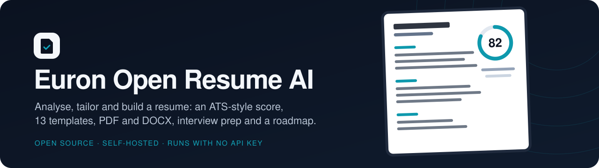
</p>

<p align="center">
  
  <a href="LICENSE"></a>
  
  
  
  
  
  
  
  
</p>

<p align="center">
  <a href="https://github.com/euron-sde-team/euron-open-resume-ai/stargazers"></a>
  <a href="https://github.com/euron-sde-team/euron-open-resume-ai/fork"></a>
  <a href="https://github.com/euron-sde-team/euron-open-resume-ai/watchers"></a>
  <br>
  <a href="https://github.com/euron-sde-team/euron-open-resume-ai/issues"></a>
  <a href="https://github.com/euron-sde-team/euron-open-resume-ai/pulls"></a>
  <a href="https://github.com/euron-sde-team/euron-open-resume-ai/commits/main"></a>
  
  <br>
  <a href="#built-by-the-team-behind-euron"></a>
</p>

<p align="center">
  <b><a href="#-quickstart">Quickstart</a></b> ·
  <b><a href="#️-architecture">Architecture</a></b> ·
  <b><a href="#-explore-the-repository">Explore the repo</a></b> ·
  <b><a href="docs/guides/api.md">API reference</a></b> ·
  <b><a href="#️-deploy-to-aws">Deploy</a></b> ·
  <b><a href="docs/architecture/security.md">Security</a></b> ·
  <b><a href="#-documentation">Docs</a></b>
</p>

**Euron Open Resume AI** is an open-source, self-hosted **resume analyser and builder**: upload a
resume or build one in a chat, get an ATS-style score and a plain list of what to fix, tailor it
to a job description, pick one of 13 templates and export a PDF or DOCX. It also writes
interview questions, a career roadmap and project ideas from the resume. It is MIT-licensed and
part of the open-source initiative of **ENGAGESPHERE TECHNOLOGY PRIVATE LIMITED**.

Members sign up on your deployment, upload a PDF, DOCX or text resume (optionally with a job
description and a company), and watch it get analysed: the original is scored, an improved
version and a cover letter are written, and missing keywords are listed against the job
description. Interview questions come in four tracks (non-technical, data structures and
algorithms, programming, system design), and a roadmap and project ideas can be generated on
demand. People without a resume build one by chatting with the builder, or start from one of 60
fictional sample resumes, and see the page update live. Admins run the deployment from `/admin`:
members, monthly AI-run quota tiers, model providers and the audit log. There are no payments.

The parts that usually go wrong in resume tools are designed in, not bolted on:

- **It works with no model at all.** A deterministic offline engine parses, scores and rewrites
  with plain heuristics and never invents a fact, so the demo, the tests and a small deployment
  need no key. Point it at any OpenAI-compatible endpoint and the same screens use a real model.
- **A resume is private by construction.** Every read and write is scoped to its owner (someone
  else's id is a `404`, never a `403`), files are uploaded only through the API and checked by
  their bytes, resume text is wrapped as untrusted data in prompts, and logs carry ids and
  counts, never what anyone wrote.
- **Exports look the same everywhere.** One canonical resume document feeds the live preview,
  the 13 templates, the PDF (headless Chromium with no network and no JavaScript) and the DOCX.

Everything runs on a laptop with no API key: a stand-in serves the model wire format, an AWS
emulator stands in for S3, SES and Secrets Manager, and it deploys to AWS with the same
Terraform.

<p align="center">
  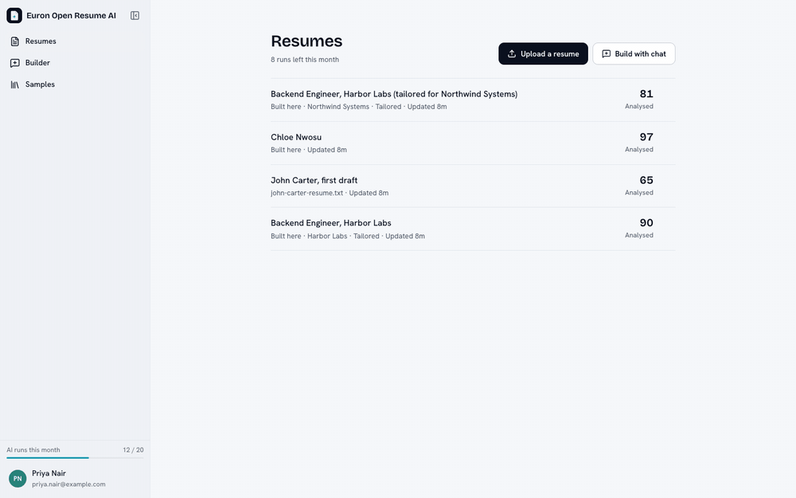
</p>

> [!NOTE]
> Everything in the tour and the screenshots ran for real: Docker Compose on a laptop, the
> offline engine doing the analysis, and S3, SES and Secrets Manager emulated locally.
> `make up && make demo` reproduces it. Add a provider key and the same screens use a real model.

<h3 align="center">Built by the team behind Euron</h3>

<p align="center">
  <sub>Euron Open Resume AI is part of the open-source initiative of ENGAGESPHERE TECHNOLOGY PRIVATE LIMITED, made by the people who build<br>the platforms below. If you like how this repository is built, come and see what we build with it.</sub>
</p>

<p align="center">
  <a href="https://euron.one"><picture><source media="(prefers-color-scheme: dark)" srcset="docs/assets/brand/euron-dark.svg"></picture></a>
  <a href="https://euronsystems.com"><picture><source media="(prefers-color-scheme: dark)" srcset="docs/assets/brand/euron-systems-dark.svg"></picture></a>
  <a href="https://alphaeuron.com"><picture><source media="(prefers-color-scheme: dark)" srcset="docs/assets/brand/alpha-euron-dark.svg"></picture></a>
</p>

<p align="center">
  <a href="https://www.instagram.com/euron_official"></a>
  <a href="https://www.linkedin.com/company/euronone/posts/"></a>
  <a href="https://x.com/euron712"></a>
  <a href="https://www.youtube.com/@Euron-official"></a>
  <a href="https://whatsapp.com/channel/0029VaeeJwq9RZAfPW9P2l07"></a>
</p>

---

## 📚 Table of contents

- [Why Euron Open Resume AI](#-why-euron-open-resume-ai)
- [At a glance](#-at-a-glance)
- [Screenshots](#️-screenshots)
- [Features](#-features)
- [Architecture](#️-architecture)
- [Tech stack](#-tech-stack)
- [Prerequisites](#-prerequisites)
- [Quickstart](#-quickstart)
- [Use a real model](#-use-a-real-model)
- [Explore the repository](#-explore-the-repository)
- [API](#-api)
- [Configuration](#️-configuration)
- [Deploy to AWS](#️-deploy-to-aws)
- [Security model](#-security-model)
- [Testing](#-testing)
- [Documentation](#-documentation)
- [Roadmap](#️-roadmap)
- [FAQ](#-faq)
- [Contributing, security and license](#-contributing-security-and-license)

## 💡 Why Euron Open Resume AI

Most resume tools are a paid service that keeps your resume. This one is a codebase you run:

- **Your people's resumes stay on your infrastructure.** A career centre, a bootcamp, a
  community or a company can offer resume help without handing every file to a third party.
- **It is honest about what it does.** The score comes from counted signals (sections present,
  quantified bullets, filler phrases, keyword coverage), the rewrite never adds a skill or a
  number that was not there, and the report says which keywords are missing against a job
  description instead of inventing them.
- **It is a real application, not a demo.** Accounts with refresh-token rotation and optional
  TOTP, owner-scoped data, per-user monthly quotas with atomic charging and refunds, a background
  pipeline with per-component retries, an admin console and an audit trail, a reproducible
  Terraform deployment, and a test suite that drives the real screens.

## 📊 At a glance

| | |
| --- | --- |
| **Resume work** | ATS-style analysis and score, improved resume, cover letter, tailoring to a job description, keyword gaps |
| **Preparation** | Interview questions in 4 tracks, career roadmap, project ideas with a resume-ready bullet each |
| **Builder** | Chat builder with a live preview, hand editing, drafts, 60 fictional sample resumes |
| **Export** | 13 templates, PDF and DOCX, a matching cover letter |
| **AI** | Any OpenAI-compatible endpoint, or the built-in deterministic offline engine |
| **Accounts** | Email and password, refresh rotation, optional TOTP, password reset by email |
| **Admin** | Members, monthly AI-run tiers and per-member overrides, providers and models, audit log |
| **Services** | `api`, `worker`, `web`, `stubs`, plus Postgres 16 and Redis 7 |
| **Locally** | `make up && make demo`, no key and no AWS account |
| **Deploy** | Terraform for AWS (Fargate, RDS, ElastiCache, S3, SES, Secrets Manager) |

## 🖼️ Screenshots

All screenshots are from the demo stack. The first rows are light, the last is dark.

<table>
  <tr>
    <td width="50%">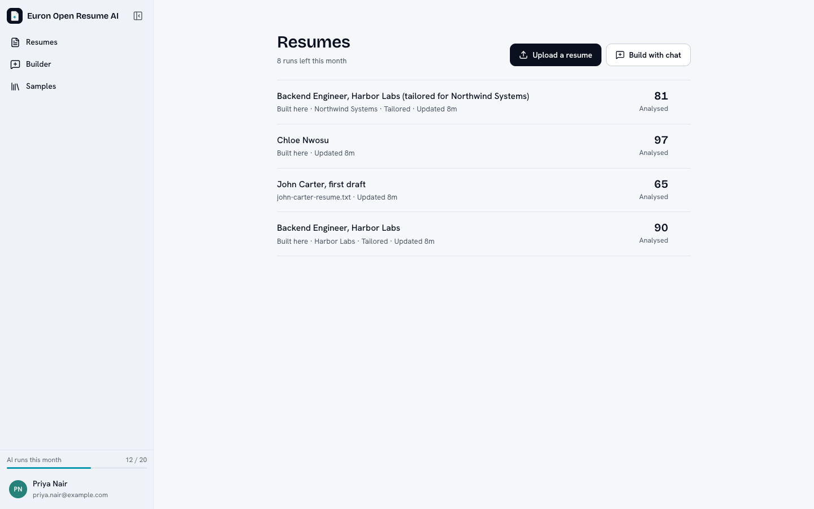<br><sub><b>Your resumes</b>: a score for each, tailored copies grouped with their original, and the month's AI runs.</sub></td>
    <td width="50%">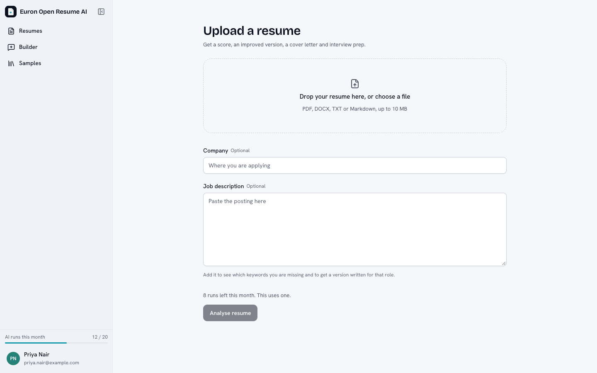<br><sub><b>Upload</b>: a PDF, DOCX or text file, with an optional job description and company.</sub></td>
  </tr>
  <tr>
    <td width="50%">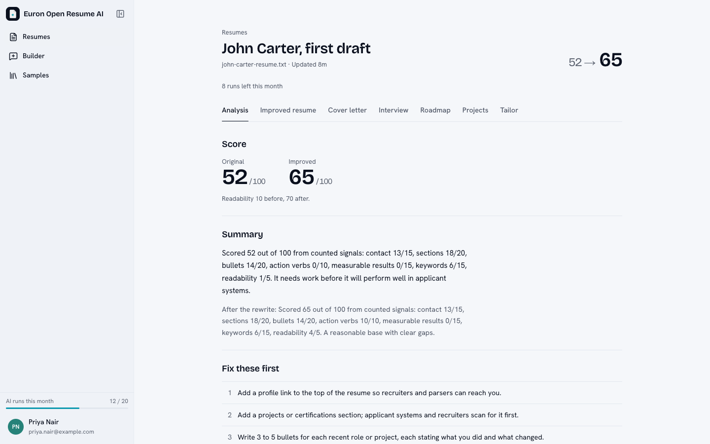<br><sub><b>The report</b>: the score before and after, missing keywords, and the fixes most worth making.</sub></td>
    <td width="50%">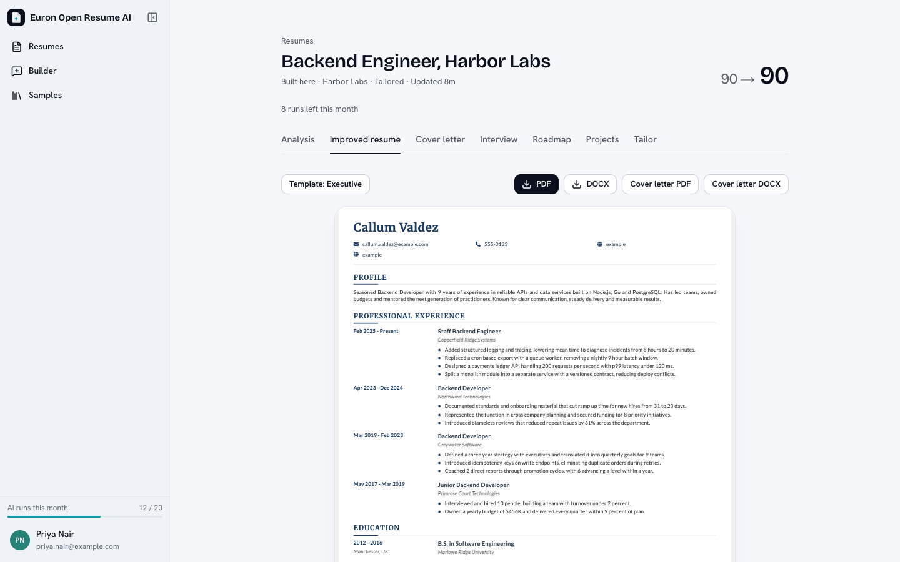<br><sub><b>The improved resume</b>: pick any of 13 templates, download PDF or DOCX.</sub></td>
  </tr>
  <tr>
    <td width="50%">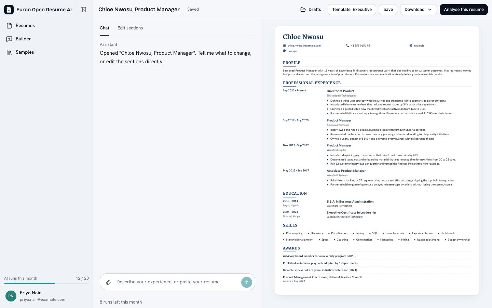<br><sub><b>Chat builder</b>: describe your experience, watch the page fill in, edit by hand.</sub></td>
    <td width="50%">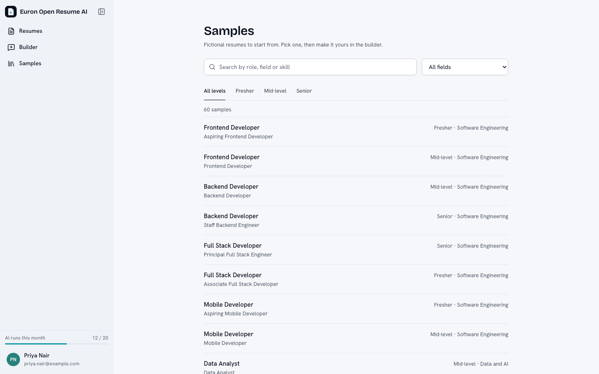<br><sub><b>Samples</b>: 60 fictional resumes across 30 roles to start from.</sub></td>
  </tr>
  <tr>
    <td width="50%">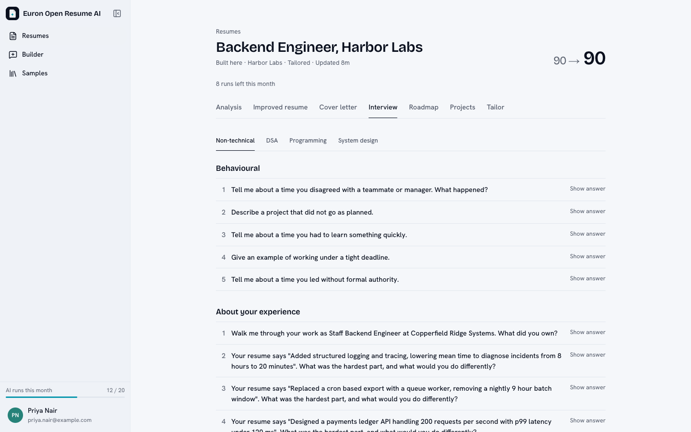<br><sub><b>Interview prep</b>: questions and model answers in four tracks.</sub></td>
    <td width="50%">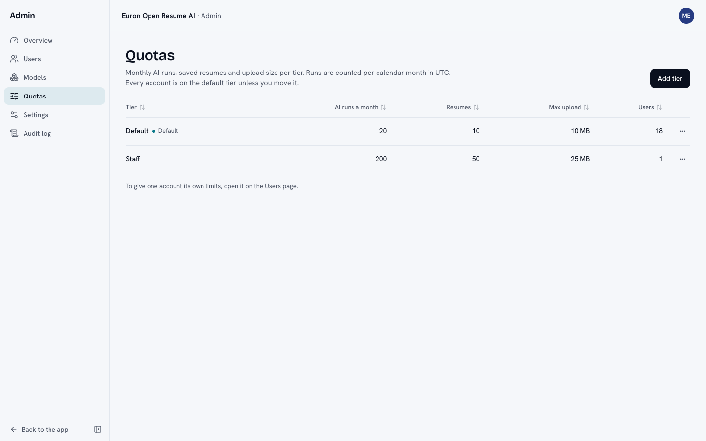<br><sub><b>Admin quotas</b>: monthly runs, resume slots and upload size per tier.</sub></td>
  </tr>
  <tr>
    <td width="50%">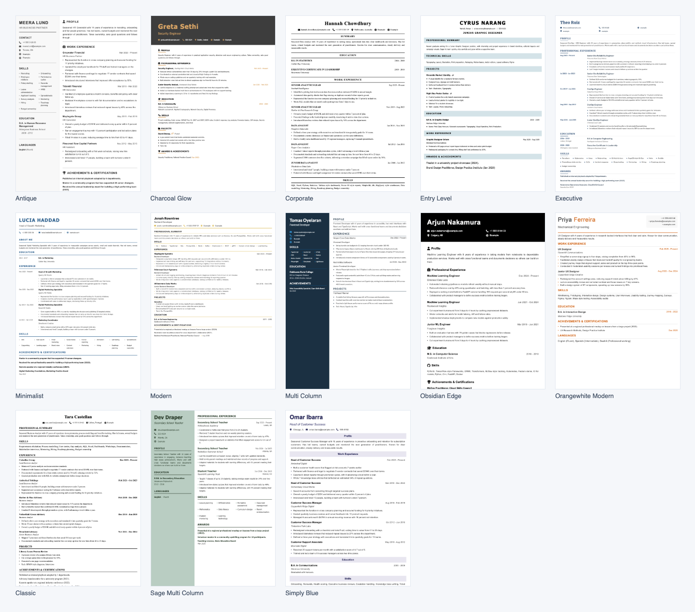<br><sub><b>13 templates</b>: single and two column, plain and designed.</sub></td>
    <td width="50%">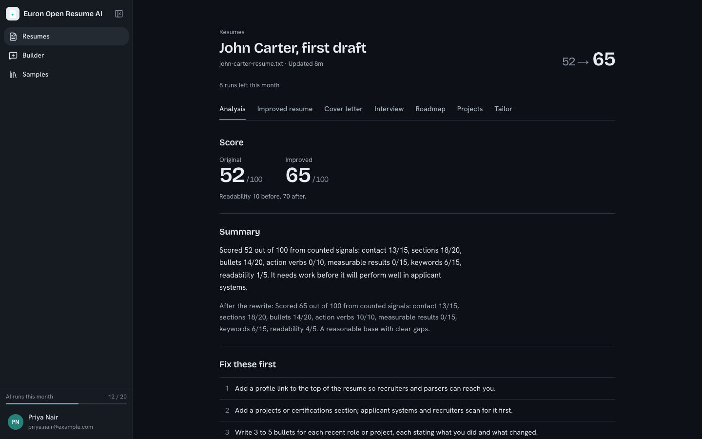<br><sub><b>Dark mode</b> everywhere in the app.</sub></td>
  </tr>
</table>

## ✨ Features

**Analyse**
- ATS-style score for the original and the improved resume, with the formatting, content and readability notes behind it
- Strengths, weaknesses, repeated phrases and a ranked list of improvements
- Keyword match against a job description, with the missing ones listed
- Tailor an existing resume to another job: a new copy is analysed and kept next to the original

**Write**
- An improved resume that keeps every fact and fixes the wording, and a cover letter
- Interview questions with answers in four tracks, a career roadmap in phases, and project ideas
- Each extra costs one AI run and is generated only when asked for, so a quota is never spent in the dark

**Build**
- Chat builder with a live preview from the same renderer the exports use
- 60 sample resumes (fictional people, companies and schools), 13 templates, drafts with autosave
- Import an existing file into the builder

**Export**
- PDF through headless Chromium with no network and no JavaScript, DOCX through `docx`
- The original upload is kept and downloadable

**Run it**
- Accounts, TOTP, password reset, sessions you can see and revoke
- Admin console: members, tiers, overrides, providers and models, settings, audit log
- Monthly AI-run quotas charged atomically before work is queued and refunded when it fails

## 🏗️ Architecture

Four deployables and two stores. The API is the only thing that touches Postgres, the object
store and the mail relay; the worker runs the analysis pipeline from a Redis queue; the web app
is a thin client of the API.

<p align="center">
  
</p>

### From upload to report

<p align="center">
  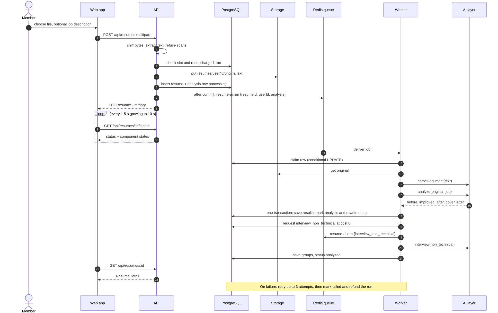
</p>

The API validates the file by its bytes, extracts the text, charges one run, stores the file
under a server-built key and enqueues a job that carries ids only. The worker claims each
component (parse and analyse, rewrite, free non-technical interview questions) and records its
status, so one failure is local, retryable and refunded. [Details](docs/architecture/resume-pipeline.md).

### Rendering

<p align="center">
  
</p>

One canonical `ResumeDocument` is the only shape the builder, the parser, the AI output, the
drafts, the templates and the DOCX builder share. The preview is the same HTML the PDF is
printed from, shown in a sandboxed iframe. [Details](docs/architecture/rendering-and-templates.md).

### Deployment

<p align="center">
  
</p>

The [high-level design](docs/architecture/HLD.md), [low-level design](docs/architecture/LLD.md),
[data model](docs/architecture/data-model.md) and the [decision records](docs/architecture/adr/README.md)
cover the rest.

## 🧰 Tech stack

| Layer | Choices |
| --- | --- |
| Monorepo | pnpm 9, Turborepo, TypeScript strict, ESLint, Prettier |
| API | Node 22, Express 5, Kysely on PostgreSQL 16, SQL migrations, BullMQ on Redis 7, zod |
| Web | Next.js 15, React 19, TanStack Query v5, Zustand, Tailwind |
| Rendering | EJS templates, `puppeteer-core` with system Chromium, `docx` |
| Parsing | `unpdf` for PDF, `mammoth` for DOCX, plain text and Markdown |
| AI | OpenAI-compatible adapter, deterministic offline engine, JSON mode with zod validation and one repair retry |
| Storage and mail | S3 (or local disk), SES or SMTP |
| Tests | Vitest unit and integration (real Postgres and Redis), Playwright with axe |
| Infrastructure | Docker Compose with Floci, Terraform modules, GitHub Actions |

## 📋 Prerequisites

- Docker with Compose v2 and about 6 GB of free memory for the full stack
- GNU Make
- For working on the code outside Docker: Node 22 and pnpm 9

## 🚀 Quickstart

```bash
git clone https://github.com/euron-sde-team/euron-open-resume-ai.git
cd euron-open-resume-ai
make up      # builds and starts everything on emulated AWS, waits until healthy
make demo    # seeds an admin, four members, sample resumes and the model catalogue
```

Then open **http://localhost:3630** and sign in. `make demo` prints the logins and the demo
password. Everything is on `localhost`:

| What | Where |
| --- | --- |
| App | http://localhost:3630 |
| API health | http://localhost:5106/api/ready |
| Mailpit (sign-up and reset emails) | http://localhost:8106 |
| Model stand-in | http://localhost:5199 |

`make help` lists every target; `make down` stops the stack and deletes its volumes.

> [!TIP]
> The demo runs on the offline engine until an admin enables the stub provider under
> **Admin, Providers**. Either way no key is needed.

## 🤖 Use a real model

Sign in as the admin, open **Admin, Providers**, add an OpenAI-compatible provider (a base URL
and a key) and a model, mark the model as the default for text, and run a new analysis. Keys are
held in the database only as an encrypted value or come from the environment. See
[connect-real-providers.md](docs/guides/connect-real-providers.md).

## 🧭 Explore the repository

```text
apps/
  api/        Express 5 API and the BullMQ worker (same image, two entrypoints)
  web/        Next.js app: resumes, builder, samples, settings, admin
  stubs/      OpenAI-compatible stand-in for local runs and end-to-end tests
packages/
  types/      Shared contracts, including the canonical ResumeDocument
  api-client/ Typed HTTP client used by the web app
  ui/         The UI kit and design tokens
  samples/    60 fictional sample resumes and the generator that validates them
db/           SQL migrations and the runner
deploy/       Compose files and env templates
infra/        Dockerfiles and Terraform modules
e2e/          Playwright specs, including axe checks in light and dark
docs/         Architecture, ADRs, guides, API reference, diagrams
```

## 🔌 API

Cookie sessions for the web app, bearer tokens for scripts. The generated OpenAPI reference is
[docs/api/openapi.yaml](docs/api/openapi.yaml) and the guide has the errors and examples:
[docs/guides/api.md](docs/guides/api.md).

```bash
# Upload a resume with a job description (after signing in and keeping the cookie jar)
curl -s -b jar.txt -F file=@resume.pdf -F company="Example Co" \
  -F jd="Looking for a backend engineer with Go and Postgres." \
  http://localhost:5106/api/resumes

# Poll its status, then fetch the report
curl -s -b jar.txt http://localhost:5106/api/resumes/$ID/status
curl -s -b jar.txt http://localhost:5106/api/resumes/$ID
```

## ⚙️ Configuration

Every setting is an environment variable read in one place
([`apps/api/src/core/config.ts`](apps/api/src/core/config.ts)) and validated at start. In
production the API refuses to boot with a default secret. `deploy/compose/.env.example` holds
safe placeholders only. The full table is in
[docs/guides/configuration.md](docs/guides/configuration.md).

## ☁️ Deploy to AWS

The Terraform in [`infra/terraform`](infra/terraform) provisions the same shape Compose runs
locally: Fargate tasks for the API, worker and web behind an application load balancer, RDS
PostgreSQL, ElastiCache Redis, an S3 bucket, SES and Secrets Manager. The local stack is
provisioned by the very same modules against Floci, so what you tested is what you deploy. See
[deploy-aws.md](docs/guides/deploy-aws.md), including the least-privilege database role and
Chromium on Fargate.

## 🔐 Security model

- **Owner scoping**: every resume query includes the user id; another member's id is a `404`.
- **Uploads**: only through the API, size-limited per tier and capped at 10 MB, typed by their
  bytes, never fetched from a user-supplied URL.
- **Prompts**: resume and job description text is wrapped as untrusted data; jobs carry ids only.
- **Rendering**: templates escape every value, links allow only `http`, `https`, `mailto` and
  `tel`, the preview is a sandboxed iframe under a `default-src 'none'` policy, and Chromium
  runs with JavaScript off and every non-`data:` request blocked.
- **Quotas**: charged atomically before work is queued, refunded on failure, rate-limited per user.
- **Logs**: field names that can hold resume content are redacted; request bodies are never logged.

The controls, the threat model and a numbered list of known gaps are in
[docs/architecture/security.md](docs/architecture/security.md) and
[threat-model.md](docs/architecture/threat-model.md). Report a vulnerability as described in
[SECURITY.md](SECURITY.md).

## 🧪 Testing

```bash
pnpm test                 # unit tests for every package
pnpm test:integration     # 157 API tests against real Postgres and Redis
pnpm e2e                  # 16 Playwright tests, including axe in light and dark
pnpm openapi --check      # the OpenAPI reference matches the routes
make sanitize             # no secrets, personal data or em dashes in tracked files
```

See [docs/guides/testing.md](docs/guides/testing.md) for the database setup and the backend matrix.

## 📖 Documentation

| Start with | |
| --- | --- |
| [Documentation index](docs/README.md) | Everything below, grouped |
| [Quickstart](docs/guides/quickstart-local.md) and [walkthrough](docs/guides/walkthrough.md) | Run it and click through every screen |
| [HLD](docs/architecture/HLD.md) and [LLD](docs/architecture/LLD.md) | How it is built |
| [Resume pipeline](docs/architecture/resume-pipeline.md), [AI engine](docs/architecture/ai-engine.md), [Rendering](docs/architecture/rendering-and-templates.md), [Quotas](docs/architecture/quotas.md) | The moving parts |
| [Decision records](docs/architecture/adr/README.md) | Why it is built this way |
| [Add a template](docs/guides/add-a-template.md) | Extend the product |
| [Operations](docs/guides/operations.md) and [troubleshooting](docs/guides/troubleshooting.md) | Run it for real |

## 🗺️ Roadmap

- Show the profile photo in the HTML templates (the DOCX export already does)
- Streaming progress for the analysis instead of polling
- More languages for the offline engine and for the sample resumes
- Optional document-level redaction of personal details before text reaches a hosted model
- A mobile client on the same API

## ❓ FAQ

**Do I need an API key?** No. The offline engine analyses and rewrites with heuristics. A model
gives richer wording and better interview answers.

**Where is a resume stored?** The original file in the object store under a server-built key,
the parsed text and results in Postgres. Deleting a resume removes its rows and its files.

**Can it invent experience?** The offline engine cannot; it only rewords what is there. With a
model, prompts forbid it and owner fields come from the original, but you should read the result.

**How is the score calculated?** From counted signals on the parsed document. The report lists
what moved it. See [ai-engine.md](docs/architecture/ai-engine.md).

**Is there billing?** No. Admins set monthly AI-run allowances per tier and per member.

**Which file types?** PDF, DOCX, TXT and Markdown. A scanned PDF with no text layer is refused
with a message, and no run is used.

**Can I add a template?** Yes, see [add-a-template.md](docs/guides/add-a-template.md).

## 🤝 Contributing, security and license

Contributions are welcome: read [CONTRIBUTING.md](CONTRIBUTING.md) and the
[Code of Conduct](CODE_OF_CONDUCT.md). Report vulnerabilities privately as described in
[SECURITY.md](SECURITY.md). Released under the [MIT License](LICENSE) by
ENGAGESPHERE TECHNOLOGY PRIVATE LIMITED. The changelog is in [CHANGELOG.md](CHANGELOG.md).
