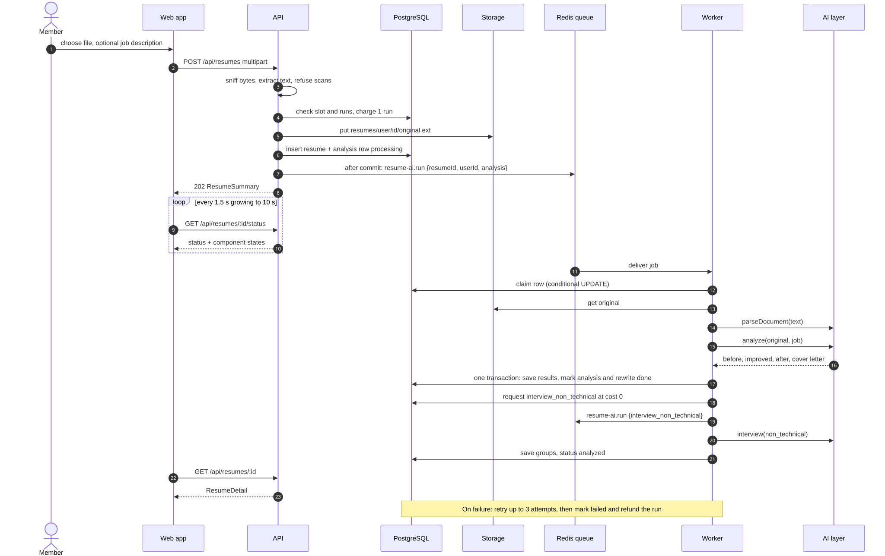

# High-level design

Euron Open Resume AI (in-app brand "Resume AI") is a self-hosted resume assistant for one
organisation or community. People sign up, upload a resume (PDF, DOCX, TXT or Markdown) or
build one with a chat builder, and get an ATS-style analysis and score of the original, an
AI-improved resume and cover letter (optionally tailored to a job description and a
company), interview questions in four tracks, a career roadmap and project ideas. They pick
one of 13 templates and export PDF or DOCX. Admins manage users, monthly AI-run quota tiers,
AI providers and models, deployment settings and the audit trail. There are no payments.

The system works with no AI key at all: a deterministic offline engine answers every task
until an admin configures a provider ([ADR 0002](adr/0002-offline-engine-as-default-ai.md)).

This page describes the system as it is built: what runs, where data lives, how a request
travels and what happens when a piece fails. Deeper topics have their own pages:

| Topic | Page |
| --- | --- |
| Layers, modules, middleware, jobs, rate limits and the web app inside the repo | [LLD.md](LLD.md) |
| Tables, enums, constraints, indexes and what is JSONB | [data-model.md](data-model.md) |
| Components, statuses, the state machine, retries, refunds and stale work | [resume-pipeline.md](resume-pipeline.md) |
| Provider resolution, structured output, the offline engine and prompt hardening | [ai-engine.md](ai-engine.md) |
| The canonical document, the 13 templates, HTML, PDF and DOCX | [rendering-and-templates.md](rendering-and-templates.md) |
| Monthly runs, tiers, overrides, costs and refunds | [quotas.md](quotas.md) |
| Security controls and known gaps | [security.md](security.md) |
| STRIDE analysis | [threat-model.md](threat-model.md) |
| Decisions and their trade-offs | [adr/](adr/README.md) |
| Running it: local quick start, configuration, AWS deployment, operations | [quickstart-local.md](../guides/quickstart-local.md), [configuration.md](../guides/configuration.md), [deploy-aws.md](../guides/deploy-aws.md), [operations.md](../guides/operations.md) |

All code paths are relative to the repository root. The diagrams are Mermaid sources in
[`docs/diagrams/`](../diagrams/context.mmd) rendered to SVG in `docs/assets/diagrams/`.

## 1. System context

Everyone uses the same web app. There are two platform roles (`users.role`):

| Role | Can open | Enforced in |
| --- | --- | --- |
| `USER` | Their own resumes, drafts, preferences, usage, sessions and data export | Every resume and draft query filters on `user_id` ([`resume.repository.ts`](../../apps/api/src/repositories/resume.repository.ts) `findOwned`, [`resume-draft.repository.ts`](../../apps/api/src/repositories/resume-draft.repository.ts)); someone else's id is a 404 |
| `ADMIN` | All of the above for their own account, plus `/admin`: accounts, tiers, overrides, providers and models, settings, audit, stats | `requireAdmin` in [`core/context.ts`](../../apps/api/src/core/context.ts), called first by every admin service function |

An admin sees accounts, usage counts and configuration. No admin endpoint returns a resume,
an analysis or an uploaded file.

The outside systems:

| System | What it is used for | Code |
| --- | --- | --- |
| Model providers (OpenAI, Anthropic, Gemini, any OpenAI-compatible endpoint, the stub) | Parsing, analysis, rewrite, cover letter, interview questions, roadmap, project ideas, builder chat | [`integrations/llm/`](../../apps/api/src/integrations/llm/index.ts) |
| Object storage (S3 private bucket, or local disk in development) | The original uploaded file, `resumes/<user>/<resume>/original.<ext>` | [`integrations/storage.ts`](../../apps/api/src/integrations/storage.ts) |
| Mail (SES v2, SMTP, or an on-disk outbox) | Email verification, password reset, the admin bootstrap link | [`integrations/mail/mailer.ts`](../../apps/api/src/integrations/mail/mailer.ts) |
| Chromium (a local binary) | PDF rendering only | [`services/resume/render/pdf.ts`](../../apps/api/src/services/resume/render/pdf.ts) |

Model providers are optional. Resume text goes to a provider only when an admin has enabled
one and its key is configured; otherwise nothing leaves the deployment.

## 2. Containers

The repository builds three images. The API image carries four entry points.

| Container | Source | Image | Listens | Role |
| --- | --- | --- | --- | --- |
| Web app | `apps/web` (Next.js 15, standalone) | [`infra/docker/web.Dockerfile`](../../infra/docker/web.Dockerfile) | 3000 (3630 on the host locally) | Pages, `/env.js` runtime config, the per-request CSP. Locally it proxies `/api/*` to the API ([`apps/web/next.config.ts`](../../apps/web/next.config.ts)) |
| API | [`apps/api/src/index.ts`](../../apps/api/src/index.ts) | [`infra/docker/api.Dockerfile`](../../infra/docker/api.Dockerfile) | 5106 | REST under `/api`, `/up` and `/api/ready`. Reads uploads, charges runs, enqueues jobs, renders previews, PDFs and DOCX |
| Worker | [`apps/api/src/worker.ts`](../../apps/api/src/worker.ts) | API image, `node dist/worker.js` | none | BullMQ workers for the `resume-ai` and `maintenance` queues and the repeatable schedules |
| Migrate (one-off) | [`db/migrate.ts`](../../db/migrate.ts) | API image, `node dist/migrate.js` | none | Applies pending SQL migrations |
| CLI (one-off) | [`apps/api/src/cli.ts`](../../apps/api/src/cli.ts) | API image, `node dist/cli.js` | none | `admin:create` and `demo:seed` |
| Stubs (local and tests only) | [`apps/stubs/server.mjs`](../../apps/stubs/server.mjs) | [`infra/docker/stubs.Dockerfile`](../../infra/docker/stubs.Dockerfile) | 5199 | A deterministic OpenAI-compatible endpoint. Never deployed to AWS |

Shared packages:

| Package | Holds |
| --- | --- |
| [`packages/types`](../../packages/types/src/index.ts) | DTOs and enums shared by the API, the web app and any native client (`ResumeDocument`, component and status enums, `Usage`, admin shapes) |
| [`packages/api-client`](../../packages/api-client/src/index.ts) | The HTTP client (single-flight refresh, cross-tab lock), typed endpoint groups, multipart upload |
| [`packages/ui`](../../packages/ui/src/index.ts) | Components and design tokens |
| [`packages/samples`](../../packages/samples/README.md) | About 60 synthetic sample resumes for the sample picker, tests and template previews |

### Deployed shape (AWS)

The composition lives in one Terraform module,
[`infra/terraform/modules/deployment/main.tf`](../../infra/terraform/modules/deployment/main.tf);
`envs/aws-dev` and `envs/aws-prod` pick sizes and safety switches.

| | aws-dev | aws-prod |
| --- | --- | --- |
| Availability zones, NAT | 2, one shared NAT | 3, one NAT per AZ |
| RDS PostgreSQL | single AZ, 3 days of backups | Multi-AZ, 14 days, deletion protection |
| ElastiCache snapshots | 1 day | 7 days |
| CloudFront and WAF | off by default (`enable_cdn = false`) | on by default (`enable_cdn = true`) |
| Log retention | 14 days | 365 days |

Task sizes default to `api` 1 vCPU and 2 GB (1 to 3 tasks), `worker` 1 vCPU and 2 GB (1 to 2
tasks) and `web` 0.25 vCPU and 512 MB (1 to 3 tasks); both envs can override them
([`modules/deployment/variables.tf`](../../infra/terraform/modules/deployment/variables.tf)).

**One origin.** The ALB routes `/api/*` and `/up` to the API and everything else to the web
app. The browser only talks to `https://<domain>`, so the refresh cookie (scoped to
`/api/auth`) is first-party and the API needs no CORS for the app itself. Requests are
short: a resume job runs in the worker and the page polls its status, so the ALB idle timeout
stays at its default of 60 s (`alb_idle_timeout`). With the CDN on, CloudFront sends a secret
`X-Origin-Verify` header the listener rules require, and passes `/api/*` uncached.

**Secrets.** JWT and refresh secrets, the TOTP key and the provider keys (`PROVIDER_KEYS`)
come from Secrets Manager and are injected by ECS as environment variables
([`modules/secrets/main.tf`](../../infra/terraform/modules/secrets/main.tf)). The database
password is not in the environment: the API reads it from a secret for each new connection
([`apps/api/src/db/connection-config.ts`](../../apps/api/src/db/connection-config.ts)).

**PDFs render in the API task, not the worker.** `GET /api/resumes/:id/download/resume.pdf`
and `POST /api/builder/export` call Chromium inside the API process
([`resume.service.ts`](../../apps/api/src/services/resume/resume.service.ts) `download`,
[`builder.controller.ts`](../../apps/api/src/controllers/builder.controller.ts)). The worker
runs only `resume-ai.run` and the two maintenance jobs. Both tasks are sized for Chromium
because they share one image, but only the API needs it.

### Local shape

`make up` runs [`deploy/compose/compose.yaml`](../../deploy/compose/compose.yaml) with
[`compose.floci.yaml`](../../deploy/compose/compose.floci.yaml): Postgres 16, Redis 7,
Mailpit, the stubs, Floci (the AWS emulator) provisioned by the
`infra/terraform/envs/local-floci` Terraform, then migrate, api, worker and web
([ADR 0010](adr/0010-floci-for-local-aws.md)).

| Service | Host port |
| --- | --- |
| web | 3630 |
| api | 5106 |
| Postgres | 5552 |
| Redis | 6489 |
| Mailpit (UI / SMTP) | 8106 / 1106 |
| Floci | 4657 |
| stubs | 5199 |

## 3. Where data lives

| Data | Store | Notes |
| --- | --- | --- |
| Accounts, sessions, tokens, quotas, usage, providers, models, settings, audit | PostgreSQL | [`0001_init.sql`](../../db/migrations/0001_init.sql) ([data-model.md](data-model.md)) |
| Resumes, per-component pipeline state, builder drafts | PostgreSQL | [`0002_resumes.sql`](../../db/migrations/0002_resumes.sql); parsed documents and AI results are JSONB |
| The original uploaded file | Object storage | Key `resumes/<user>/<resume>/original.<ext>`; only the key is in the database |
| Queue jobs (ids only) | Redis (BullMQ) | `resume-ai` and `maintenance` queues; a job never carries resume text |
| Rate-limit buckets `rl:<name>` | Redis | An in-memory insurance limiter takes over when Redis is down |
| Provider API keys | Environment or Secrets Manager | Never in the database, a response or a log line |

Rendered HTML, PDFs and DOCX files are not stored. They are produced on demand from the
stored JSON and returned with `Cache-Control: no-store`.

## 4. A request, end to end

A request enters through the web app (or `curl`), goes through Helmet, CORS, the origin check,
JSON parsing, a route-level rate limiter and `authenticate`, then a controller that parses
input with zod and calls a service. Services take an `Actor`, not an Express request, and
repositories take an optional transaction. Errors are `HttpError` instances turned into
`{ error, code, details?, requestId }` by the global handler in
[`app.ts`](../../apps/api/src/app.ts). See [LLD.md](LLD.md) for the layers.

## 5. The analysis pipeline end to end

1. **Upload.** `POST /api/resumes` reads one multipart file in memory, capped at the smaller
   of the tier's `max_upload_mb` and 10 MB ([`middleware/multipart.ts`](../../apps/api/src/middleware/multipart.ts)).
   The type is decided from the bytes (`%PDF-` anywhere in the first 1 KB, or a zip with
   `word/document.xml`, or UTF-8 text with a `.txt`/`.md` name), never from the client's
   content type ([`extract.ts`](../../apps/api/src/services/resume/extract.ts) `sniffFile`).
2. **Refuse early.** The API extracts the text once before charging anything. A scan or an
   image-only PDF (fewer than 40 characters) is a 422 `NO_TEXT`, and nothing is charged.
3. **Charge, store, insert.** The API checks the resume slot and the month's runs, charges one
   run, writes the file to storage, then inserts the `resumes` row and the `analysis`
   component row in one transaction under a per-user advisory lock. Any failure before the
   queue refunds the run and deletes the file.
4. **Enqueue after commit.** The `resume-ai.run` job `{ resumeId, userId, component }` is
   added to Redis only after the transaction commits ([`core/effects.ts`](../../apps/api/src/core/effects.ts)).
   The response is `202` with a `ResumeSummary`.
5. **Poll.** The web app polls `GET /api/resumes/:id/status` at 1.5 s, growing by 1.5x to a
   10 s ceiling, and refetches the full report when any component changes status
   ([`apps/web/src/lib/resume/polling.ts`](../../apps/web/src/lib/resume/polling.ts)).
6. **Claim.** The worker takes the `analysis` row with a conditional `UPDATE`. A duplicate
   delivery, a second worker or a finished job claims nothing and does nothing.
7. **Extract and parse.** The worker reads the original from storage, extracts text again,
   and turns it into a `ResumeDocument` (a model, or the heuristic parser offline).
8. **Analyse.** One `analyze` task produces the report for the original (`before`), the
   rewritten document (`improved`), the report for the rewrite (`after`) and the cover letter.
   `analysis` and `rewrite` are two rows written by one job.
9. **Save.** One transaction stores the JSONB results, the score, marks both rows `done` and
   recomputes the resume status.
10. **Chain.** The default pipeline then requests the non-technical interview set at no extra
    charge. Other interview tracks, the roadmap and project ideas are generated on demand,
    one run each.
11. **Failure.** A retryable failure goes back to the queue with exponential backoff, up to 3
    attempts. The last failure marks the rows `failed` with a message safe to show, and gives
    the charged run back. A problem with the user's file is never retried.

Details and the edge cases (stale claims, the reaper, double clicks) are in
[resume-pipeline.md](resume-pipeline.md).

## 6. Preview and export

The preview is server-rendered HTML shown in an iframe with an empty `sandbox` and `srcdoc`.
PDF is the same HTML printed by a locked-down Chromium; DOCX is built by the `docx` library
from the same canonical document, with no HTML involved. See
[rendering-and-templates.md](rendering-and-templates.md).

## 7. Failure behaviour

| What fails | What happens |
| --- | --- |
| No model configured | Every AI task runs on the offline engine. `GET /api/admin/integrations` and the admin settings page say whether a provider is configured |
| A configured model errors or times out | The job retries; on the last attempt the component is `failed` and the run is refunded. It never silently falls back to the offline engine, so admins see real provider problems |
| A model returns invalid JSON | One repair retry with the validation errors fed back, then `AI_BAD_OUTPUT` |
| Redis is down | Rate limits fall back to a per-process memory limiter. Enqueueing fails, so the new resume is failed and refunded (`dispatch`). `/api/ready` returns 503 |
| The worker crashes mid-job | The claim stays held for up to 10 minutes; the component is failed and refunded by the reaper after 30 minutes, the next time anyone reads that resume. See the gap in [resume-pipeline.md](resume-pipeline.md#6-stale-work) |
| Chromium is missing or busy | `POST /api/builder/export` answers 503 `PDF_UNAVAILABLE`. The saved-resume PDF download answers the same 503. Waiting renders are capped at 25 |
| Mail fails | Sending never throws into the request; the result says whether it was handed to a transport |
| Postgres is down | `/api/ready` is 503 and the load balancer takes the task out |

## 8. Operations

| Concern | Where |
| --- | --- |
| Migrations | Forward-only, checksummed, one advisory lock ([`db/migrate.ts`](../../db/migrate.ts)); run as a one-off task, or on boot with `MIGRATE_ON_BOOT` |
| Health | `/up` (process), `/api/ready` (Postgres and Redis) |
| Logs | pino JSON with field-name redaction ([`core/logger.ts`](../../apps/api/src/core/logger.ts)); resume text, job descriptions and tokens never reach a line |
| Shutdown | SIGTERM stops accepting, closes queues, Redis and the pool; the worker closes its BullMQ workers |
| First admin | `node dist/cli.js admin:create --email ...` emails a set-password link |
| Scheduled jobs | `maintenance.lift-suspensions` every 5 minutes, `maintenance.purge-accounts` every 6 hours |
