# Rendering and templates

One canonical document, one mapper, 13 server-rendered EJS templates, and three outputs: an
HTML preview, a PDF and a DOCX. The decisions are
[ADR 0004](adr/0004-server-rendered-templates-and-previews.md) (one source for preview, PDF
and DOCX), [ADR 0005](adr/0005-canonical-resume-document.md) (the data shape) and
[ADR 0008](adr/0008-chromium-with-no-network-for-pdfs.md) (the PDF engine). Code: [`services/resume/render/`](../../apps/api/src/services/resume/render/index.ts)
and [`templates/`](../../apps/api/src/templates).



## 1. The canonical document

`ResumeDocument` ([`packages/types/src/resume.ts`](../../packages/types/src/resume.ts)) is the
only resume shape the system moves around: the builder edits it, the parser produces it, the
model rewrites it, drafts store it, the templates render it, the DOCX builder reads it.

| Field | Shape |
| --- | --- |
| `personal` | `fullName`, `headline`, `email`, `phone`, `location`, `photoDataUrl` |
| `links` | `portfolio`, `github`, `linkedin`, `twitter`, `youtube`, `other: [{ label, url }]` |
| `summary` | string |
| `experience` | `[{ title, company, location, start, end, bullets, description }]` |
| `education` | `[{ degree, institution, location, start, end, details, score }]` |
| `skills` | `[{ category, items }]` |
| `projects` | `[{ name, description, link, tech, bullets }]` |
| `certifications`, `languages`, `achievements` | lists of small objects or strings |

Everything is optional. Normalisation is tolerant by design and never throws: strings are
trimmed and stripped of control characters (a NUL byte also breaks JSONB), lists and strings
are capped, empty entries vanish, unknown keys are dropped, link fields survive only as
`http`, `https`, `mailto` or `tel` URLs (a bare `github.com/me` gets `https://`), and
`photoDataUrl` survives only as `data:image/(png|jpeg|gif);base64,...`.

Two normalisers exist today, with slightly different caps:

| | Used on | Caps that differ |
| --- | --- | --- |
| `documentSchema` / `normalizeDocument` in [`ai/document.ts`](../../apps/api/src/services/resume/ai/document.ts) | Request bodies (render, export, drafts, from-document), model output | summary 2,500, experience 25, photo 4,000,000 characters |
| `normaliseDocument` in [`resume/document.ts`](../../apps/api/src/services/resume/document.ts) | Documents the pipeline stores (`original`, `improved`) | summary 3,000, experience 30, photo 1,000,000 characters |

Both are tolerant (they truncate rather than reject), so a stored document always renders.
They are separate implementations of the same idea and are a candidate for merging
([security.md](security.md#known-gaps)).

## 2. The mapper

The 13 templates were written against a legacy shape
(`updatedResume = { personalInfo, summary, skills, coreCompetencies, experience[{ companyName,
designation, duration, description[{ point }] }], education, projects, achievements,
languages }`). [`render/mapper.ts`](../../apps/api/src/services/resume/render/mapper.ts)
converts the canonical document to it (`toResumeTemplateData`) and the cover letter to its own
shape (`toCoverLetterTemplateData`). It is deliberately tolerant: a section it cannot read
becomes an empty section, never an exception. Bullets are accepted as `{ point }[]`,
strings, one blob split on bullet characters, or nothing. Links are filtered here and again
inside the templates.

## 3. The 13 templates

Template ids are a closed list, `TEMPLATE_IDS` in `packages/types`. The registry
([`render/registry.ts`](../../apps/api/src/services/resume/render/registry.ts)) holds the
picker metadata and the DOCX look that matches each family.

| Id | Name | Columns | ATS-friendly | DOCX layout | Bundled fonts |
| --- | --- | --- | --- | --- | --- |
| `resume_template` | Classic | 1 | yes | classic | |
| `antique_resume_template` | Antique | 2 | no | classic | |
| `corporate_resume_template` | Corporate | 1 | yes | classic | |
| `executive_resume_template` | Executive | 1 | yes | classic | Lato, Merriweather |
| `minimalist_resume_template` | Minimalist | 1 | yes | compact | |
| `modern_resume_template` | Modern (default) | 1 | yes | modern | |
| `multi_column_resume_template` | Multi-column | 2 | no | modern | Lato |
| `obsidian_edge_resume_template` | Obsidian Edge | 1 | no | modern | |
| `sage_multi_column_resume_template` | Sage | 2 | no | modern | |
| `simply_blue_resume_template` | Simply Blue | 1 | yes | modern | |
| `charcoal_glow_template` | Charcoal Glow | 1 | no | modern | |
| `orangewhite_modern_template` | Orange and White | 1 | yes | modern | |
| `entry_level_template` | Entry level | 1 | yes | compact | |

`atsFriendly` is the registry's own claim about a plain single-column flow that parsers read
reliably; two-column and heavily designed templates are marked `false`. `GET /api/templates`
returns the list with name, description, columns and accent colour. A cover letter template
(`cover_letter.ejs`) is separate and uses no template id.

**The template id is never a path.** `resolveTemplateId` is an allow-list lookup: an id from
the list, a `<stem>.ejs` spelling of one, or a legacy short stem such as `modern`;
everything else is the default. Request bodies that carry a `templateId` must also match
`z.enum(TEMPLATE_IDS)`. Resume upload with an unknown `templateId` is `400 UNKNOWN_TEMPLATE`;
a `?template=` query on render or download that is unknown falls back to the default.

**Which template.** A resume stores `template_id`; `user_preferences.default_template` is a
per-user default the picker preselects; the `?template=` query re-renders the same resume
with another template without changing it.

**All template output is escaped.** No template uses `<%-` (unescaped output). Every value
goes through EJS's `<%=` HTML escaping, and links through `safeHref`.

## 4. HTML

[`render/html.ts`](../../apps/api/src/services/resume/render/html.ts):

- Templates are read once from the templates directory (`TEMPLATES_DIR`, else the first of
  the source tree and bundle layouts that contains `resume_template.ejs`), compiled once and
  cached.
- `finish()` injects into `<head>`: a `Content-Security-Policy` meta tag, the FontAwesome
  stylesheet and the `@font-face` rules for the fonts the template asks for.
- **Nothing needs the network at render time.** FontAwesome 6 (solid and brands) is inlined
  with its woff2 files as base64; Lato and Merriweather come from `@fontsource` and are
  inlined as base64 `@font-face`. The result is one self-contained document.

`DOCUMENT_CSP` is:

```
default-src 'none'; style-src 'unsafe-inline'; img-src data:; font-src data:
```

No script, no connection, no frame, no external stylesheet or font. Inline styles are allowed
because the templates are styled inline. The meta tag travels with the document into the PDF
engine and the iframe; the HTTP routes repeat it as a header.

The HTML templates do not render the profile photo. `photoDataUrl` is accepted, validated and
shown in the builder form, and placed in the DOCX, but no EJS template emits an ``
([security.md](security.md#known-gaps)).

## 5. Preview

Two endpoints produce the preview HTML, and the web app shows both in the same component.

| Endpoint | Input | Used for |
| --- | --- | --- |
| `POST /api/builder/render` | `{ document, templateId }` in the body (512 KB cap), `120 per minute` | The builder: a live preview while typing, debounced 450 ms |
| `GET /api/resumes/:id/render?template=` | A stored resume's `improved` document (or the builder `original`) | The report: the improved resume in the chosen template |

Both answer `text/html; charset=utf-8` with `Cache-Control: no-store`. The builder route sends
`Content-Security-Policy: DOCUMENT_CSP` and `X-Content-Type-Options: nosniff`. The stored-resume
route sends a stricter policy from `htmlHeaders`: `DOCUMENT_CSP`, `base-uri 'none'`,
`form-action 'none'`, `sandbox` and `frame-ancestors 'self' <allowed origins>`.

The web app puts the HTML in `<iframe sandbox="" srcDoc={html} referrerPolicy="no-referrer">`
([`preview-frame.tsx`](../../apps/web/src/components/resume/preview-frame.tsx)). An empty
`sandbox` means no scripts, no forms, no popups and an opaque origin, whatever the resume
contains. The page is laid out at 816 px wide and scaled to fit the column. The web app's own
CSP allows `frame-src 'self' blob:` and nothing remote. The preview is the same markup the PDF
is printed from, so what you see is what you download, apart from the print media rules.

A resume that is not ready has no preview: `409 NOT_READY` until `improved` exists (a builder
resume previews its `original`).

## 6. PDF

[`render/pdf.ts`](../../apps/api/src/services/resume/render/pdf.ts) drives one long-lived
Chromium through `puppeteer-core`. It bundles no browser: the binary comes from
`CHROMIUM_PATH`, else the first of the usual system locations (and, in development, the
Playwright cache).

| Control | Value |
| --- | --- |
| Network | Request interception is on; every request whose URL does not start with `data:` or `about:` is aborted (`blockedbyclient`) |
| JavaScript | Off (`setJavaScriptEnabled(false)`) |
| Content | `page.setContent(html)`; nothing is navigated to, and there is no file or http origin |
| Page | A4 (`210mm x 297mm`), `printBackground: true`, `preferCSSPageSize: true`; templates declare `@page { size: A4 }` with their own margins |
| Time | 20 s for load, 30 s for the print itself |
| Concurrency | `PDF_CONCURRENCY` pages at once (default 2); further renders wait in a queue of at most 25, then `PdfUnavailableError` ("The PDF engine is busy") |
| Recycling | The browser restarts after `PDF_RECYCLE_PAGES` (default 100) pages, to cap Chromium's memory growth |
| Sandbox | Chromium's own sandbox is on unless `CHROMIUM_NO_SANDBOX=1`, which the container images set because a user-namespace sandbox is not available inside a container. The network block is the compensating control |
| Process | One browser per API process, killed on exit |

In the deployed images Chromium is the Debian package with Noto and Liberation fonts, so a
resume in any script prints without boxes.

The PDF endpoints:

| Endpoint | Input | Output |
| --- | --- | --- |
| `GET /api/resumes/:id/download/resume.pdf` and `cover-letter.pdf` | The stored resume | `application/pdf`, `attachment`, `no-store` |
| `POST /api/builder/export` with `format: "pdf"` | `{ document, templateId, format }` in the body | The same, 20 per minute |

## 7. DOCX

[`render/docx.ts`](../../apps/api/src/services/resume/render/docx.ts) uses the `docx` library
directly from the canonical document. There is no HTML to Word conversion: a header table
(identity left, links right, or photo, identity and links when a photo exists), one block per
section, and a borderless table per experience, project or education entry so the role,
company and dates stay aligned when bullets wrap. It opens the same in Word, LibreOffice and
Google Docs. Three layouts (`modern`, `classic`, `compact`) and one accent colour per
template family; the registry maps each of the 13 templates to a layout. The DOCX look
matches a template's family; it is not a pixel copy of the HTML.

DOCX safety: every string is trimmed; links pass `cleanUrl` (`http`, `https`, `mailto`,
`tel`); the photo must be a `png`, `jpeg` or `gif` data URL whose magic bytes agree with its
declared type (`decodePhoto`), otherwise it is skipped without failing the render.

## 8. Downloads

`GET /api/resumes/:id/download/:what`, `what` one of `original`, `resume.pdf`,
`resume.docx`, `cover-letter.pdf`, `cover-letter.docx`:

- `original` streams the stored upload (`404` for a builder resume or a missing file).
- `resume.*` renders the `improved` document (a builder resume falls back to its `original`);
  `409 NOT_READY` otherwise. `?template=` re-renders in another template.
- `cover-letter.*` needs the stored letter and a document; the author's contact details come
  from the resume.
- File names come from the title, slugified (`NFKD`, ASCII word characters, at most 60
  characters), with an RFC 6266 `Content-Disposition` carrying an ASCII fallback and the real
  UTF-8 name.

## 9. Links and images

[`render/safe.ts`](../../apps/api/src/services/resume/render/safe.ts) is the one place that
decides what a link is:

| Function | Rule |
| --- | --- |
| `cleanUrl(input)` | `http`, `https`, `mailto` or `tel` only. Rejects control characters, whitespace, `//` protocol-relative, and anything over 2,048 characters. A bare domain (`linkedin.com/in/ada`) becomes `https://`; `host:8080/x` is read as a host and port. Returns `undefined` when unusable |
| `safeHref(input)` | `cleanUrl` or `"#"`, which a template renders as a dead link |
| `safeDataImage(input)` | `data:image/(png\|jpeg\|gif);base64,...`, at most 4,000,000 characters |
| `escapeHtml(input)` | For the few places a string is built by hand |

The web app has a matching client-side `safeHref` for links in the report
([`apps/web/src/lib/resume/safe-href.ts`](../../apps/web/src/lib/resume/safe-href.ts)); links
that fail it render as plain text.

## 10. Template previews script

[`apps/api/scripts/template-previews.ts`](../../apps/api/scripts/template-previews.ts) renders
each template to a PNG through the same locked-down engine (`htmlToPng`, JavaScript off,
same request blocking) for documentation and the picker.
